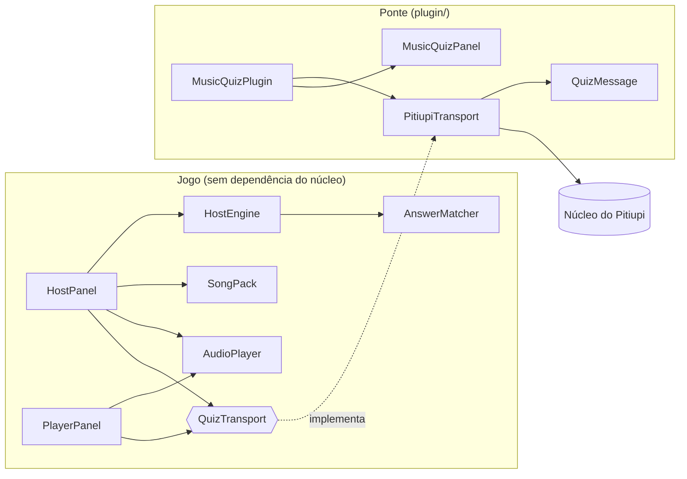
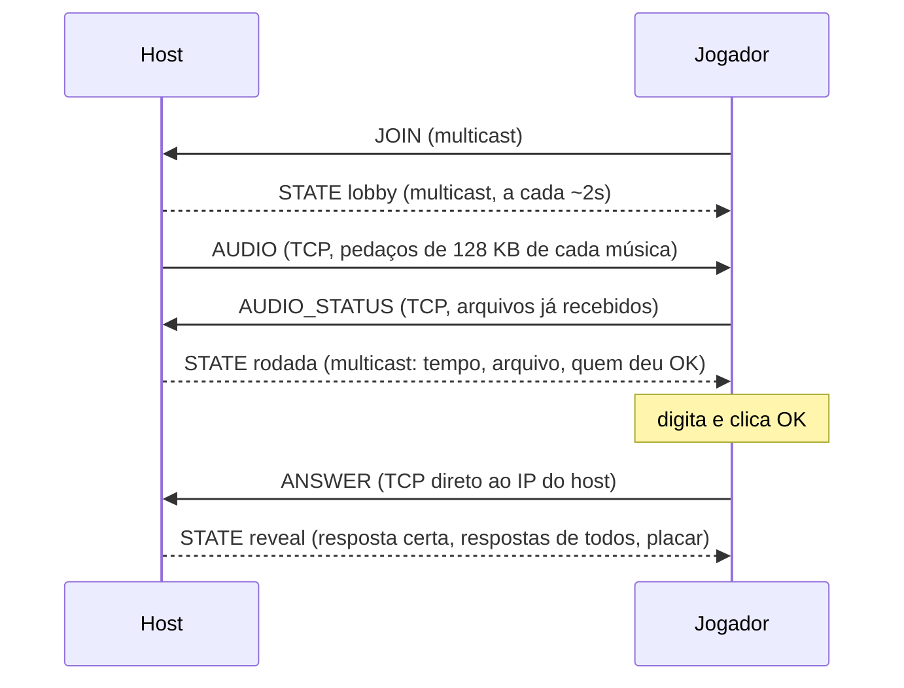

# Music Quiz — plugin do Pitiupi

Quiz de música para salas do [Pitiupi](https://git.alice.ufsj.edu.br/fls/pitiupi), inspirado no
[AnimeMusicQuiz](https://animemusicquiz.com).

Uma sala tem **um host** (que toca as músicas e **não joga**) e **dois ou mais jogadores**. O host **envia os áudios aos jogadores pela rede** antes de começar. Em cada
rodada toca uma música; cada jogador digita o nome e confirma com **OK**. A resposta travada só é
revelada quando a rodada termina.

## Sumário

- [Como o jogo funciona](#como-o-jogo-funciona)
- [Instalação](#instalação)
- [Como jogar](#como-jogar)
- [Pacote de músicas](#pacote-de-músicas)
- [Arquitetura](#arquitetura)
- [Rede e sigilo das respostas](#rede-e-sigilo-das-respostas)
- [Estrutura de pastas](#estrutura-de-pastas)
- [Testes](#testes)
- [Estado do projeto](#estado-do-projeto)
- [Limitações conhecidas](#limitações-conhecidas)

## Como o jogo funciona

1. Os jogadores entram na sala.
2. O host escolhe a pasta de músicas, o número de rodadas, o tempo de cada rodada e o mínimo de
   jogadores, e clica em **Iniciar**.
3. **Preparação:** o host envia a cada jogador os arquivos das músicas sorteadas (por TCP, em
   pedaços). A primeira rodada só começa quando todos confirmam que receberam tudo. O host pode
   clicar em **Começar sem esperar**, e depois de 2 minutos a partida começa de qualquer jeito.
4. A cada rodada a música toca e a contagem regressiva começa. Cada jogador digita a resposta e
   clica em **OK** (ou aperta Enter). Depois do OK a resposta fica **travada**.
5. A rodada termina quando **todos** os jogadores deram OK **ou** o tempo acaba.
6. Reveal: aparecem a resposta certa, o que cada um respondeu (com ✔/✘) e o placar.
7. O host clica em **Próxima**. Quando as músicas acabam, aparece o ranking final.

Regras de pontuação e de sala:

- Cada acerto vale **1 ponto**. Quem não respondeu a tempo fica sem resposta e não pontua.
- A pontuação é zerada a cada novo **Iniciar**.
- O mínimo de jogadores é configurável (padrão 2). O host nunca conta como jogador.
- Quem entra com a partida em andamento joga a partir da **próxima** rodada.
- Quem sai no meio da rodada não trava os demais: se todos os que restam já deram OK, ou se não
  sobra ninguém, a rodada termina.
- A comparação de respostas ignora acentos, maiúsculas e pontuação, e tolera erros pequenos de
  digitação (ver [`src/pitiupi/musicquiz`](src/pitiupi/musicquiz/README.md#answermatcher)).

## Instalação

Pré-requisitos do próprio Pitiupi(veja o README do repositório
principal). Para o quiz:

1. Copie esta pasta para `plugins/` do repositório (`plugins/musicquiz`).
2. Acrescente o conteúdo de [`registry-entry.json`](registry-entry.json) como mais uma entrada em
   `plugins.registry.json`, separada das outras por vírgula:

   ```json
   {
     "id": "musicquiz",
     "dir": "plugins/musicquiz",
     "build": "ant",
     "jar": "dist/pitiupi.musicquiz.jar",
     "menuCategory": "Jogos"
   }
   ```
3. Na raiz do repositório:

   ```bash
   ./scripts/pitiupi.sh run --all          # Linux
   scripts\pitiupi.cmd run --all           # Windows
   ```

Todos os participantes (host e jogadores) precisam ter **o mesmo JAR** do quiz.

## Como jogar

Abra a aba **Music Quiz**. Cada pessoa escolhe **Host (não joga)** ou **Jogador**.

**Host**

| Campo | Para que serve |
| --- | --- |
| Músicas | Pasta com os áudios e o `songs.tsv` |
| Rodadas | Quantas músicas sortear do pacote (padrão 10) |
| Segundos | Duração de cada rodada (padrão 30) |
| Mín. jogadores | Quantos jogadores são necessários para iniciar (padrão 2) |
| Tocar a música neste PC | Se marcado, o host toca o áudio nos próprios alto-falantes |
| Enviar as músicas aos jogadores pela rede | Se marcado (padrão), cada jogador recebe os arquivos e toca no próprio computador |
| Começar sem esperar | Durante a preparação, começa sem esperar quem ainda não recebeu tudo |
| Iniciar / Próxima / Voltar ao lobby | Controle da partida |

**Jogador:** **Entrar na sala**, esperar a preparação (aparece "Recebendo músicas"), digitar a
resposta na rodada e confirmar com **OK**. O áudio recebido toca no computador do jogador
("Tocar a música enviada pelo host", ligado por padrão; desligue se o jogador está na mesma sala
física do host e quer ouvir só o som dele). Como alternativa, "Se não vier, tocar de uma pasta
daqui" usa um pacote de músicas que o jogador já tenha.

## Pacote de músicas

Uma pasta com os arquivos de áudio e um `songs.tsv` em UTF-8. Cada linha tem o nome do arquivo e as
respostas aceitas, separados por **TAB**; as respostas ficam separadas por `|`:

```
# arquivo<TAB>resposta1|resposta2|...
01.wav	Bohemian Rhapsody|bohemian rhapsody queen
02.wav	Imagine|imagine john lennon
```

- A **primeira** resposta é a mostrada no reveal; as demais também contam como acerto.
- Use nomes de arquivo **neutros** (`01.wav`): o nome do arquivo viaja no pacote da rodada e poderia
  entregar a resposta.
- Só WAV, AIFF e AU tocam sem biblioteca adicional. MP3 exigiria uma biblioteca extra.
- **Tamanho:** o host envia os arquivos inteiros a cada jogador. WAV em qualidade de CD pesa cerca de
  10 MB por minuto; com muitas rodadas ou músicas longas, a preparação demora, principalmente por VPN.
  Prefira trechos curtos (15 a 30 s) ou rodadas poucas.
- Linhas vazias e linhas iniciadas por `#` são ignoradas. Linha inválida ou arquivo inexistente
  gera um aviso no log do host e só aquela música é descartada.

## Arquitetura

O jogo foi separado do núcleo do Pitiupi de propósito: tudo o que é regra, tela e áudio fica em
[`src/pitiupi/musicquiz`](src/pitiupi/musicquiz/README.md) e não depende da API do núcleo. A única
camada que conhece o Pitiupi é a **ponte**, em
[`src/pitiupi/musicquiz/plugin`](src/pitiupi/musicquiz/plugin/README.md). Isso permite testar o jogo
sozinho (pasta [`standalone`](standalone/README.md)).



Uma rodada, do ponto de vista da rede:



O **host é a autoridade**: guarda o estado da partida, decide os acertos e pontua. Os jogadores só
enviam respostas e mostram o que recebem.

## Rede e sigilo das respostas

- **Estado da partida, entrada e saída da sala:** UDP multicast para a sala, como o chat. Durante a
  rodada o estado informa apenas **quem já deu OK**, nunca o texto das respostas.
- **Respostas:** TCP direto ao IP do host, nunca para a sala. O host anuncia o próprio IP em todo
  pacote de estado; se o jogador ainda não o conhece, não envia e tenta de novo.
- **Áudio:** o host envia os arquivos a cada jogador por **TCP** (confiável), em pedaços de 128 KB que
  o jogador remonta mesmo fora de ordem ou repetidos. Cada jogador informa ao host os arquivos que já
  tem; o host reenvia só o que faltar (até 3 passadas).
- **Perda de pacotes (UDP):** o host reenvia o estado a cada ~2s e o jogador reenvia a entrada na
  sala e a resposta até o host confirmar.
- **Limites do sigilo:** o Pitiupi não usa criptografia, então quem capturar pacotes da rede ainda
  poderia ler uma resposta, e um cliente adulterado poderia se passar pelo host. Para uma sala de
  aula isso evita a cópia casual, mas não é segurança contra alguém decidido a trapacear.

Requisitos de rede (os mesmos do Pitiupi): mesma porta no login, mesma sub-rede, firewall liberando
UDP e TCP nessa porta, e uma rede que não bloqueie multicast nem isole os clientes (comum em Wi-Fi
institucional ou de visitantes).

## Estrutura de pastas

| Pasta / arquivo | Conteúdo |
| --- | --- |
| [`src/`](src/README.md) | Código-fonte e arquivo SPI do plugin |
| [`src/pitiupi/musicquiz/`](src/pitiupi/musicquiz/README.md) | O jogo: motor, pacotes, telas, áudio |
| [`src/pitiupi/musicquiz/plugin/`](src/pitiupi/musicquiz/plugin/README.md) | A ponte com o núcleo do Pitiupi |
| [`src/META-INF/services/`](src/META-INF/services/README.md) | Registro do plugin via SPI |
| [`nbproject/`](nbproject/README.md) | Configuração de build do NetBeans/Ant |
| [`standalone/`](standalone/README.md) | Testes e demo sem o Pitiupi |
| `build.xml` | Script Ant (importa `nbproject/build-impl.xml`) |
| `registry-entry.json` | Entrada para o `plugins.registry.json` |


## Limitações conhecidas

- Host e jogador **no mesmo computador** não funcionam: o núcleo não suporta TCP para o próprio
  host, e as respostas e o áudio vão por TCP.
- A rede precisa permitir multicast; sem ele a sala não se forma.
- Nomes de usuário iguais se misturam no jogo, porque a identificação é pelo nome do login.
- O plugin não usa as abas de sessão do chat; a aba é um painel simples.
- Só WAV/AIFF/AU tocam sem biblioteca adicional.
