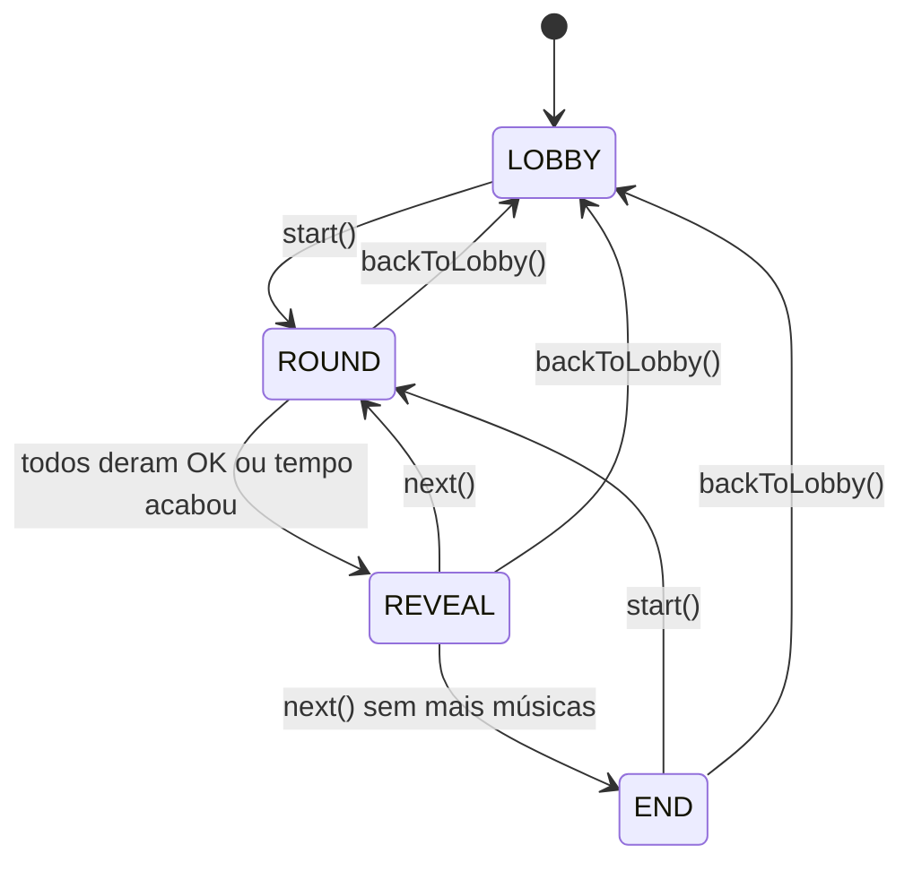

# `pitiupi.musicquiz` — o jogo

Regras, pacote de rede, telas e áudio do quiz. **Nada aqui importa o núcleo do Pitiupi**: a conversa
com a rede acontece através da interface [`QuizTransport`](#quiztransport), implementada pela ponte
em [`plugin/`](plugin/README.md) (no Pitiupi) ou por `Loopback` (nos testes).

## Visão geral das classes

| Classe | Papel |
| --- | --- |
| [`QuizPacket`](#quizpacket) | Único tipo de mensagem do jogo (entrar, sair, estado, resposta) |
| [`HostEngine`](#hostengine) | Estado e regras da partida; roda só no host |
| [`AnswerMatcher`](#answermatcher) | Compara a resposta digitada com as aceitas |
| [`Song`](#song-e-songpack) / [`SongPack`](#song-e-songpack) | Uma música e o carregamento do `songs.tsv` |
| [`AudioPlayer`](#audioplayer) | Toca um arquivo de áudio por vez |
| [`QuizTransport`](#quiztransport) | Fronteira entre o jogo e a rede |
| [`Render`](#render) | Transforma um estado em texto para exibir |
| [`HostPanel`](#hostpanel) | Tela do host |
| [`PlayerPanel`](#playerpanel) | Tela do jogador |

## `QuizPacket`

Classe `Serializable` com campos públicos. Dentro do Pitiupi viaja embrulhada em **uma** mensagem do
núcleo ([`QuizMessage`](plugin/README.md)), então só um tipo precisa ser declarado ao núcleo.

- **`Kind`:** `JOIN`, `LEAVE` (jogador → sala), `ANSWER` (jogador → host), `STATE` (host → todos).
- **`Phase`:** `LOBBY`, `ROUND`, `REVEAL`, `END`.

| Campo | Usado em | Significado |
| --- | --- | --- |
| `kind`, `sender`, `senderIp` | todos | Tipo, nome de quem enviou e IP (preenchido pela ponte; o host é localizado por ele) |
| `round`, `text`, `ready` | `ANSWER` | Rodada, texto digitado e se a resposta foi confirmada |
| `phase`, `totalRounds`, `players`, `scores` | `STATE` | Fase, total de rodadas, jogadores e placar |
| `durationMs`, `clip`, `readyPlayers` | `STATE` em `ROUND` | Tempo restante, nome do arquivo de áudio, quem já deu OK |
| `correctAnswer`, `answers`, `correct` | `STATE` em `REVEAL` | Resposta certa, respostas de cada um e se acertou |

A resposta certa e as respostas dos jogadores **só** entram no pacote na fase `REVEAL`; durante a
rodada o estado nunca as carrega.

## `HostEngine`

Máquina de estados da partida. Não conhece rede nem tela: recebe eventos e entrega pacotes `STATE`
por um `Consumer<QuizPacket>`. O relógio é injetável (`LongSupplier`), o que torna o motor testável.

| Método | O que faz |
| --- | --- |
| `configure(songs, roundMs, minPlayers)` | Define músicas, duração e mínimo de jogadores (só fora de uma rodada) |
| `join(nome)` / `leave(nome)` | Entrada e saída; o nome do host é ignorado como jogador |
| `start()` | Zera o placar e inicia; devolve mensagem de erro (sem músicas, jogadores insuficientes) ou `null` |
| `onAnswer(...)` | Registra a resposta; ignora fase errada, rodada errada, quem não está na rodada e resposta já travada |
| `tick()` | Encerra a rodada se o tempo acabou (chamar com frequência) |
| `heartbeat()` | Reenvia o estado atual; chamado a cada ~2s por causa da perda de pacotes UDP |
| `next()` / `backToLobby()` | Avança para a próxima rodada ou volta ao lobby |
| `setAudioHooks(onPlay, onStop)` | Callbacks para tocar e parar o áudio do host |

Detalhes de comportamento:

- A cada rodada o motor tira uma "foto" dos jogadores (`roundPlayers`); quem entra depois só joga a
  partir da próxima rodada.
- A rodada termina quando `ready` contém todos de `roundPlayers`, ou no `tick()` após o prazo.
- Acerto = `AnswerMatcher.matches(...)`; cada acerto soma `POINTS` (1).
- Os métodos são `synchronized`, pois eventos chegam de threads diferentes (rede, timer, interface).

## `AnswerMatcher`

- `normalize(texto)`: remove acentos (Unicode NFD), converte para minúsculas e troca tudo que não é
  letra ou número por espaço, colapsando espaços.
- `matches(resposta, aceitas)`: compara a resposta normalizada com cada resposta aceita normalizada.
  Igualdade exata sempre vale; além disso há tolerância por distância de Levenshtein que depende do
  tamanho da resposta aceita:

| Tamanho da resposta aceita (normalizada) | Erros tolerados |
| --- | --- |
| menos de 5 caracteres | 0 (tem que ser igual) |
| de 5 a 9 caracteres | 1 |
| 10 caracteres ou mais | 2 |

Resposta vazia nunca acerta.

## `Song` e `SongPack`

- `Song`: arquivo de áudio + lista de respostas aceitas; `title` é a primeira (mostrada no reveal).
- `SongPack.load(pasta, avisos)`: lê `songs.tsv` (UTF-8). Cada linha: `arquivo<TAB>resp1|resp2|...`.
  Ignora linhas vazias e as iniciadas por `#`. Linha inválida, arquivo inexistente ou linha sem
  respostas viram um aviso (com o número da linha) e a música é descartada.
- `SongPack.pick(todas, rodadas, seed)`: embaralha com a semente dada e limita ao número de rodadas.

## `AudioPlayer`

Toca **um** arquivo por vez com `javax.sound.sampled.Clip` (`play` interrompe o anterior; `stop`
para). Sem bibliotecas extras, só lê **WAV, AIFF e AU**. Falhas (formato não suportado, arquivo
ilegível) viram um aviso por callback em vez de exceção.

## `QuizTransport`

Interface que isola o jogo da rede:

| Método | Contrato |
| --- | --- |
| `selfName()` | Nome do usuário local |
| `send(pacote)` | Envia para a sala toda |
| `sendToHost(pacote)` | Envia **somente** ao host. Usado nas respostas; se o endereço do host ainda é desconhecido, **não envia** (nunca cai para a sala) |
| `setListener(consumidor)` | Quem recebe os pacotes; pode ser chamado de qualquer thread |

Implementações: `PitiupiTransport` (rede real, em [`plugin/`](plugin/README.md)) e `Loopback`
(memória, em [`../../../standalone`](../../../standalone/README.md)).

## `Render`

`Render.describe(estado)` gera o texto exibido para cada fase (lobby, rodada, reveal com ✔/✘ e
placar, fim de jogo) e `scoreboard(estado)` gera o placar ordenado por pontos. É usado pelas duas
telas.

## `HostPanel`

Tela do host: campos de pasta, rodadas, segundos e mínimo de jogadores; botões **Iniciar**,
**Próxima**, **Voltar ao lobby**; caixa "Tocar a música neste PC"; log da partida. Cria o
`HostEngine`, liga o áudio e encaminha os pacotes recebidos (`JOIN`, `LEAVE`, `ANSWER`) ao motor.
Um `Timer` de 200 ms chama `tick()` e, a cada 10 ciclos (~2 s), `heartbeat()`. O log evita repetir
a mesma mensagem quando o estado é reenviado.

## `PlayerPanel`

Tela do jogador: **Entrar na sala**, campo de resposta, **OK**, contagem regressiva e área de
resultados. Só reage a pacotes `STATE`. Detalhes:

- A resposta é enviada com `sendToHost` e fica travada depois do OK.
- Como UDP perde pacotes, a cada ~2 s o jogador reenvia o `JOIN` enquanto não aparecer na lista de
  jogadores do host, e reenvia a resposta se o host ainda não o listar como "pronto".
- A opção "Tocar a música aqui" usa o campo `clip` do estado para tocar o arquivo da rodada de uma
  pasta local; se o arquivo não existir, avisa na tela.
